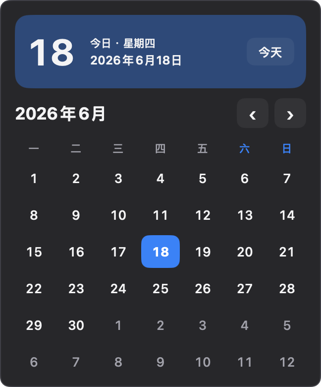
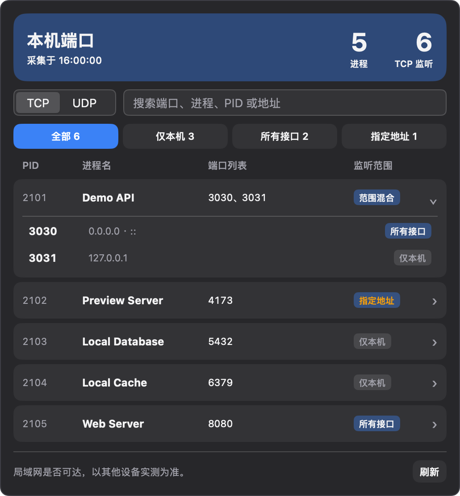
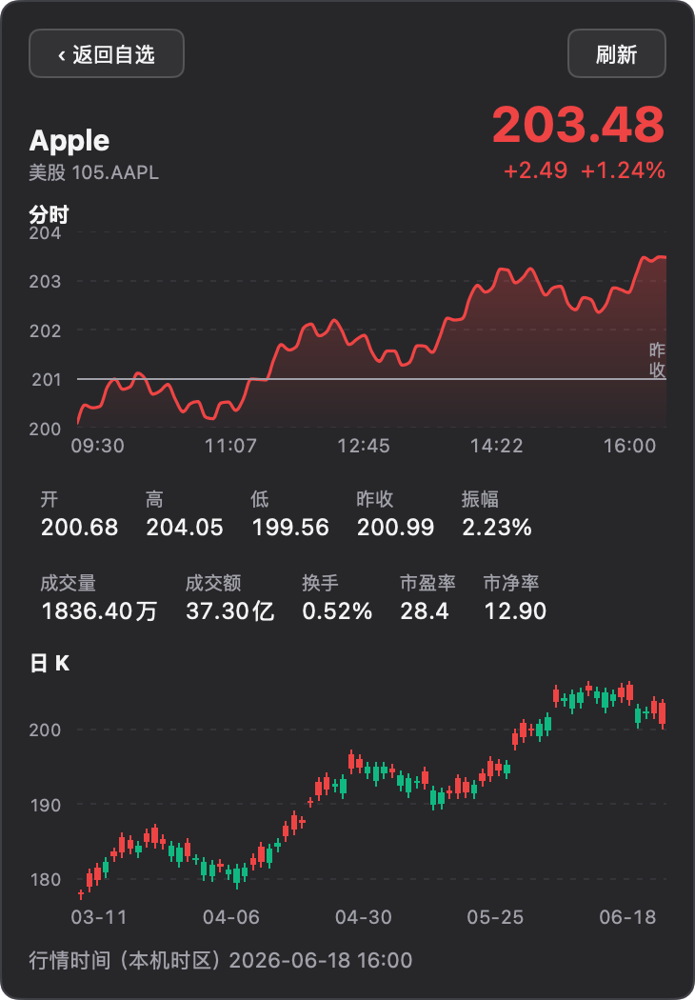

# Metrix.Bar 实用看板

三个可通过 Metrix.Bar 看板源安装的菜单栏看板。

| 看板 | 功能 |
| --- | --- |
| 日历 | 中文月历，支持翻月、选择日期和回到今天。 |
| 本机端口 | 在 macOS 上按进程查看 TCP 监听和 UDP 绑定，支持搜索及按监听范围筛选。 |
| 行情看板 | 查看美股、港股和 A 股的自选报价、分时和日 K。行情来自东方财富。 |

## 看板截图

截图使用示例数据。

### 日历



### 本机端口



### 行情看板



## 安装

在 Metrix.Bar 的「看板源」添加以下地址，刷新目录后安装所需看板。

```text
https://raw.githubusercontent.com/JasonChou0v0/metrix-bar-dashboards/main/index.json
```

## 启动本机端口采集

在 macOS 上下载或克隆本仓库，从仓库目录运行采集脚本，并保持终端窗口打开。

```sh
sh collect-local-ports.sh --watch
```

脚本每 15 秒读取一次系统套接字清单，将快照写入 `~/.local/state/metrix-bar/local-ports/snapshot.tsv`。快照仅供当前用户的看板读取。按 `Ctrl+C` 可停止采集。监听范围由绑定地址判断，局域网可达性以另一台设备的实测结果为准。

## 配置行情看板

在看板输入参数中编辑「标的列表」，用逗号分隔。示例为 `US.AAPL,HK.00005,SH.601398`。点击列表中的标的即可查看图表。

`index.json` 位于仓库根目录，`.bar` 文件放在 `dashboards/`，截图放在 `screenshots/`。修改 `.bar` 后需更新其版本及索引中的 SHA-256 摘要。[Metrix.Bar 看板源文档](https://metrix.bar/zh/docs/registries)
